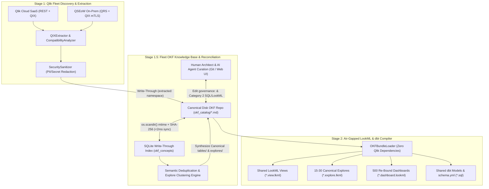

# Product Requirements Document (PRD): Qlik-Looker-OKF Migration Accelerator

| Document Metadata | Details |
| :--- | :--- |
| **Product Name** | Qlik-Looker-OKF Migration Accelerator |
| **Target Repository** | `Qlik-Looker-OKF` |
| **Architecture** | 100% Native Open Knowledge Format (OKF v0.2) — Zero Legacy `canonical_ir.json` Baggage |
| **Baseline Reference** | `Enterprise_Qlik_to_Looker` |
| **Target Scale** | 500+ Qlik Sense Applications (Qlik Cloud SaaS & QSEoW On-Premises) |
| **Runtime Constraint** | 100% Python 3.10+ Standard Library (Zero Mandatory Third-Party Packages) |

---

## 1. Executive Summary & Product Vision

In version 2.0, the **Enterprise Qlik-to-Looker Migration Accelerator** established an air-gapped, two-stage pipeline that extracts a Qlik Sense application's metadata into a single `canonical_ir.json` contract (Stage 1) and compiles that contract into LookML and dbt artifacts (Stage 2).

While a 1-to-1 app-to-JSON pipeline works well for single-application migrations, migrating an enterprise estate of **500+ Qlik applications** introduces a fundamental architectural challenge: **Qlik is application-centric (every `.qvf` embeds its own duplicate table definitions, join graphs, and Set Analysis measures), whereas Looker is semantic-model-centric (governed, reusable Views and Explores).** A naive 1-to-1 compilation of 500 Qlik apps produces 500 duplicate LookML Explores and thousands of redundant LookML Views.

**Version 3.0** re-engineers the intermediate contract from isolated per-app JSON blobs to a **Fleet-Scoped Open Knowledge Format (OKF v0.2) Knowledge Base** backed by a zero-drift SQLite write-through index, and introduces **Stage 1.5 (Fleet Semantic Reconciliation & Explore Consolidation)**. This enables migration teams and AI agents to:
1. Extract 500+ Qlik applications with zero row-data egress and full **3-Tier Compatibility Auditing** (Categories 1, 2, and 3) down to every individual sheet and visual tile.
2. Deduplicate thousands of siloed Qlik tables and measures into **15–30 canonical Looker Explores** (`explores/*.md`), **~100 canonical Views** (`tables/*.md`), and a unified metric library (`metrics/*.md`).
3. Re-bind all 500 Qlik applications' dashboards (`apps/*.md`) to those shared Canonical Explores before generating a single line of LookML.
4. Deliver the resulting OKF repository as a permanent **"Day 2" Enterprise Semantic Knowledge Base** for business users and AI assistants.

> [!IMPORTANT]
> **Core Architectural Invariant:** Version 3.0 preserves the strict air-gapped decoupling enforced by [test_stage_separation.py](../tests/test_stage_separation.py) and maintains the **100% Python 3.10+ Standard Library** zero-dependency guarantee outlined in [README.md](../README.md).

---

## 2. Problem Statement & Core Challenges at 500-App Scale

1. **LookML Sprawl from 1-to-1 Compilation:**
   In a typical 500-app Qlik estate, 3,000+ in-memory Qlik tables trace back to only ~80–120 physical data warehouse tables or QVD files. Compiling each app independently in [generator.py](../enterprise_qlik/stage2_lookml/generator.py) creates unmaintainable LookML duplication.
2. **Duplicated Category 2 Engineering Effort:**
   When a complex Qlik construct (e.g., a `RESIDENT` aggregation table or a `P()`/`E()` Set Analysis cohort measure) is shared across 30 Qlik apps, an app-siloed JSON audit flags it as 30 separate Category 2 modeling tasks (`30 × 4 hrs = 120 hrs`) instead of recognizing that modeling it once in a shared Explore/dbt model solves it for all 30 apps.
3. **LLM Context Window & Human PR Review Bottlenecks:**
   Monolithic per-app JSON files intertwine 24-column dashboard layout coordinates with data model schemas. Feeding 50 monolithic JSON files into an AI coding agent—or asking a Lead Data Architect to review a 40,000-line JSON diff in Git—is impractical.
4. **Loss of Lineage on "Day 2":**
   Once LookML is generated from flat JSON snapshots, the JSON is discarded. Business stakeholders and AI assistants have no human-readable documentation mapping legacy Qlik dashboard KPIs and Set Analysis expressions to the new Looker Explores.

---

## 3. Target End-to-End Architecture (3-Stage Pipeline)



---

## 4. Architectural Decision Records (ADRs) & Rationales

This section documents the six foundational architectural choices made for v3.0 and the specific engineering rationales behind each decision.

### ADR-01: Adopt Fleet-Scoped OKF (v0.2) Over Per-App Monolithic JSON
* **Decision:** Replace per-app `canonical_ir.json` files with a **Fleet-Scoped OKF v0.2 repository** (`okf_catalog/`) where shared data assets (`tables/*.md`, `metrics/*.md`, `explores/*.md`) exist as first-class, deduplicated concept files linked to per-app catalog files (`apps/*.md`).
* **Rationale:**
  1. **Concept-Level Identity:** In OKF, `tables/fct_orders.md` is a single canonical concept referenced by 60 apps (`referenced_by_apps`), naturally modeling the many-to-one collapse from 500 Qlik apps to ~20 Looker Explores.
  2. **Targeted AI Agent Context:** An AI agent remediating a Category 2 metric or reconciling an Explore reads only the relevant 2–3 KB `.md` files without loading megabytes of unrelated dashboard widget `x/y` coordinates.
  3. **Git-Native Architect Governance:** Data architects can review, comment on, and approve the 20 proposed Looker Explores via standard Markdown Pull Requests before Stage 2 compiles LookML.
  4. **Day-2 Knowledge Base:** The Markdown body of each OKF file becomes living documentation injected into LookML `description:` fields and dbt `schema.yml` files.

---

### ADR-02: Right-Sized 3-Tier OKF Granularity (~630 Files vs. ~35,000 Files)
* **Concern Mitigated:** A naive OKF mapping that creates a separate `.md` file for every chart widget, table column, and compatibility finding across 500 apps (~70 concepts/app) would generate **~35,000 small files**, degrading filesystem I/O, slowing `.zip` exports, and hitting OS path-length limits.
* **Decision:** Restrict OKF file creation to **coarse-grained domain concepts**:
  1. **`tables/<slug>.md` (~80–120 files across 500 apps):** One file per deduplicated table, embedding all its columns, keys, and QVS load script lineage.
  2. **`explores/<slug>.md` (~15–30 files across 500 apps):** One file per consolidated Looker Explore, embedding its join graph and canonical dimensions/measures.
  3. **`metrics/<slug>.md` (~50–100 files across 500 apps):** Dedicated concept files *only* for shared Master Measures and Category 2 complex metrics requiring cross-app reconciliation.
  4. **`apps/<app_id>.md` (500 files across 500 apps):** One file per Qlik application containing all of its sheets, 24-column visual widget layouts, and Category 1/2/3 compatibility audit findings, with Markdown links to the shared `explores/*.md` and `tables/*.md`.
  5. **Reserved Root Files (`index.md`, `log.md`).**
* **Rationale:**
  * Keeps a 500-app enterprise migration at **~650–750 `.md` files total** (a 98% reduction in file count).
  * Complete directory traversal (`os.scandir()`) across ~700 files executes in **< 2 milliseconds** on macOS, Linux, and Windows.
  * Filenames use deterministic 32-character ASCII slugs + 6-character hash suffixes (e.g., `metrics/yoy_gross_margin_excl_a1b2c3.md`), while full business titles remain in YAML frontmatter (`title:`), eliminating path-length and special-character collisions.

---

### ADR-03: Zero-Dependency YAML 1.2 Frontmatter via `json.dumps()` Scalars & Fenced Code Blocks
* **Concern Mitigated:** The application must run 100% on the Python 3.10+ standard library without requiring `PyYAML`, yet Qlik Set Analysis expressions (`Sum({$<[Order:Status]={'Paid'}, Year={"$(=Max(Year)-1)"}>} [Net # Sales])`) contain colons, curly braces, hashes, quotes, and dollar signs that break naive YAML serializers.
* **Decision:**
  1. **JSON-Encoded YAML 1.2 Scalars:** Because YAML 1.2 is a strict superset of JSON, the standard-library OKF frontmatter emitter formats top-level keys as readable block YAML, but serializes every scalar value, list, and inline map using Python's C-accelerated `json.dumps()`.
  2. **Fenced Code Blocks for Raw Scripts:** Multi-line Qlik load scripts (`RESIDENT`, `INLINE`, `SECTION ACCESS`) and proposed LookML/dbt SQL are placed in Markdown fenced code blocks (` ```qlik ` / ` ```lookml ` / ` ```sql `) in the document body rather than inside YAML frontmatter.
* **Rationale:**
  * **Zero Escaping Bugs:** `json.dumps()` guarantees 100% valid escaping of any Qlik expression character inside double quotes with zero external dependencies.
  * **C-Speed Parsing in Stdlib:** The standard-library frontmatter reader parses each key's value using `json.loads()` at native C speed (with optional `yaml.safe_load()` fallback if a user manually edits frontmatter into multi-line block YAML in an environment where `PyYAML` is installed).

---

### ADR-04: Zero-Drift Storage Engine ("Disk OKF is Truth; SQLite is a Derived Write-Through Index")
* **Concern Mitigated:** Having both a SQLite database (for the Web Studio UI) and `.md` files on disk (for Git, CLI, and AI agents) creates bi-directional state drift if both act as independent mutable stores.
* **Decision:**
  * Establish the **`okf_catalog/` directory on disk as the single canonical source of truth**.
  * Treat SQLite's `okf_concepts` table as a **derived read-through / write-through index**.
* **Mechanism:**
  1. **Atomic Write-Through (Web UI $\rightarrow$ Disk $\rightarrow$ SQLite):** Every mutation in the Web Studio UI (e.g., moving an app to Wave 1, assigning a Lead, approving an Explore merge) writes the updated `.md` file to disk first, records its nanosecond modification timestamp (`st_mtime_ns`) and `content_sha256`, and updates the SQLite index row in the same transaction.
  2. **Sub-2ms Incremental Sync on Read (Disk $\rightarrow$ SQLite):** Before serving Web Studio read endpoints, a lightweight sync check scans `okf_catalog/` via `os.scandir()`. Any file whose `st_mtime_ns` differs from SQLite's cached `mtime_ns` (e.g., edited in VS Code by an architect or updated via `git pull`) is re-parsed and re-indexed in `< 1 ms`.
  3. **Optimistic Concurrency Check:** Web UI write requests include the loaded `content_sha256`; if an external edit occurred on disk simultaneously, non-overlapping sections auto-merge or trigger a conflict prompt.
* **Rationale:** Delivers sub-10ms SQLite query performance for the 6-tab Web Studio UI while guaranteeing 100% real-time consistency with Git and local file edits—without external file-watcher dependencies like `watchdog`.

---

### ADR-05: Dual-Namespace Partitioning (`extracted:` vs. `governance:`)
* **Concern Mitigated:** Re-running Stage 1 extraction (`🔄 Re-Extract App`) on a Qlik app after an architect or AI agent has already mapped its tables/fields to a Canonical Explore or assigned it to a Migration Wave could overwrite human curation.
* **Decision:** Partition every OKF concept file into two isolated frontmatter namespaces and two fenced Markdown body regions:
  * **`extracted:` frontmatter + `<!-- BEGIN AUTO-GENERATED CATALOG -->` body:** Exclusively owned by Stage 1 (`QIXExtractor`, `CompatibilityAnalyzer`). Updated on re-extraction.
  * **`governance:` frontmatter + `<!-- BEGIN CURATED NOTES -->` body:** Exclusively owned by Stage 1.5, the Wave Planner, Human Architects, and AI Remediation Agents. Strictly preserved during Stage 1 re-extraction.
* **Rationale:** Allows safe, idempotent re-extraction from live Qlik tenants at any point in a 6-month migration program without losing a single architect override, wave assignment, or LookML mapping.

---

### ADR-06: Cross-Fleet Shared Remediation Tracking in the 3-Tier Compatibility Audit
* **Decision:** Link every per-visual or per-script Category 2 finding in `apps/<app_id>.md` to its corresponding shared concept in `tables/<slug>.md` or `metrics/<slug>.md`.
* **Rationale:**
  * Preserves the exact visual inspection experience in Stage 1 App Studio ([app.js](../enterprise_qlik/web/static/app.js)): migration leads still see which specific charts on a dashboard are **Category 1 (Direct LookML)**, **Category 2 (LookML/dbt Modeling Required)**, or **Category 3 (Incompatible/Deprecated)**.
  * Adds **Fleet Deduplication Intelligence**: When a Category 2 finding on a chart points to a shared table or metric already mapped in a Canonical Explore, the UI displays:
    `⚡ Shared across 24 apps — Resolved by canonical explore [explores/core_order_analytics] (0 incremental hrs)`.

---

## 5. OKF v0.2 Directory & Schema Specification

### 5.1 Repository Directory Layout
```text
okf_catalog/
├── index.md                                 # OKF v0.2 bundle root + fleet inventory TOC
├── log.md                                   # ISO-8601 audit log of extractions, PII scrubbing & merges
├── explores/                                # ~15-30 Canonical Looker Explores (Stage 1.5 output)
│   ├── core_order_analytics.md              # type: explore
│   └── enterprise_gl_finance.md             # type: explore
├── tables/                                  # ~80-120 Deduplicated Physical/Transform Tables
│   ├── fct_order_details.md                 # type: table
│   ├── dim_customers.md                     # type: table
│   └── dim_products.md                      # type: table
├── metrics/                                 # Shared Master Measures & Reconciled Cat-2 Metrics
│   ├── net_emea_revenue.md                  # type: metric
│   └── repeat_buyer_cohort_sales.md         # type: metric
└── apps/                                    # 500 Per-App Catalogs (Sheets, 24-Col Visuals, 3-Tier Audit)
    ├── app_sales_001.md                     # type: qlik_app
    └── app_treasury_002.md                  # type: qlik_app
```

---

### 5.2 Schema Example 1: Canonical Explore (`explores/core_order_analytics.md`)
```markdown
---
okf_version: "0.2"
type: "explore"
title: "Core Order & Commercial Analytics"
description: "Unified Looker Explore consolidating 38 regional Qlik Sales & Margin applications."
status: "approved"
timestamp: "2026-11-12T16:40:00Z"
extracted:
  cluster_similarity_score: 0.84
  source_app_count: 38
  member_apps: ["apps/app_sales_001", "apps/app_emea_margin_014"]
governance:
  model_name: "commercial_analytics"
  explore_name: "order_details"
  base_view: "tables/fct_order_details"
  approved_by: "Gavin Looker"
  target_wave: "wave1"
  joins:
    - view: "tables/dim_customers"
      type: "left_outer"
      relationship: "many_to_one"
      sql_on: "${order_details.customer_id} = ${dim_customers.customer_id}"
    - view: "tables/dim_products"
      type: "left_outer"
      relationship: "many_to_one"
      sql_on: "${order_details.product_id} = ${dim_products.product_id}"
  shared_metrics: ["metrics/net_emea_revenue", "metrics/repeat_buyer_cohort_sales"]
---

<!-- BEGIN CURATED NOTES -->
## Architectural Consolidation Notes
Consolidates 38 regional sales apps that previously loaded `Orders.qvd`, `Customers.qvd`, and `Products.qvd` independently.
* Legacy Qlik field aliases `CustID`, `Customer_Key`, and `KUNNR` are normalized to `dim_customers.customer_id`.
<!-- END CURATED NOTES -->

<!-- BEGIN AUTO-GENERATED CATALOG -->
## Linked Concepts
* Base Fact Table: [tables/fct_order_details](../tables/fct_order_details.md)
* Joined Dimensions: [tables/dim_customers](../tables/dim_customers.md), [tables/dim_products](../tables/dim_products.md)
* Re-bound Applications: [apps/app_sales_001](../apps/app_sales_001.md)
<!-- END AUTO-GENERATED CATALOG -->
```

---

### 5.3 Schema Example 2: Deduplicated Table (`tables/fct_order_details.md`)
```markdown
---
okf_version: "0.2"
type: "table"
title: "fct_order_details"
description: "Line-item order transactions fact table."
status: "active"
timestamp: "2026-11-12T16:40:00Z"
extracted:
  physical_sources: ["lib://DataWarehouse/Orders.qvd", "bigquery.raw_commerce.orders"]
  is_fact: true
  max_row_count: 14500000
  referenced_by_apps: ["apps/app_sales_001", "apps/app_emea_margin_014"]
  compatibility_category: 2
  finding_types: ["QVS_LOAD_SCRIPT_ETL", "SECTION_ACCESS"]
  fields:
    - { name: "order_id", data_type: "STRING", is_primary_key: true, source_aliases: ["OrderID", "ORDER_KEY"] }
    - { name: "customer_id", data_type: "STRING", is_primary_key: false, source_aliases: ["CustomerID", "Cust_ID"] }
    - { name: "sales_amount", data_type: "NUMERIC", is_primary_key: false, source_aliases: ["Sales", "GrossSales"] }
governance:
  lookml_view_name: "order_details"
  requires_upstream_dbt: true
  dbt_model_name: "fct_order_details"
  remediation_status: "resolved"
---

<!-- BEGIN CURATED NOTES -->
## Upstream dbt Transformation Plan (Category 2 Remediation)
Replaces the in-memory Qlik `RESIDENT RawOrders GROUP BY OrderID` script transformation across 38 apps with a single governed dbt model (`models/marts/fct_order_details.sql`).
<!-- END CURATED NOTES -->

<!-- BEGIN AUTO-GENERATED CATALOG -->
## Representative Qlik Load Script (Sanitized)
```qlik
Orders_Fact:
LOAD OrderID as order_id, CustomerID as customer_id, Sum(Sales) as sales_amount
RESIDENT Raw_Order_Lines
GROUP BY OrderID, CustomerID;
```
<!-- END AUTO-GENERATED CATALOG -->
```

---

### 5.4 Schema Example 3: Per-App Visual & Compatibility Catalog (`apps/app_sales_001.md`)
```markdown
---
okf_version: "0.2"
type: "qlik_app"
app_id: "app-sales-001"
title: "Global Enterprise Sales & Margin"
status: "active"
timestamp: "2026-11-12T16:40:00Z"
extracted:
  tenant_id: "inst-cloud-001"
  environment_type: "cloud"
  stream_or_space: "Commercial Production"
  space_type: "managed"
  sanitized: true
  compatibility_summary:
    cat1_count: 18
    cat2_count: 4
    cat3_count: 1
    raw_effort_hours: 19.5
    deduplicated_effort_hours: 3.5
  sheets:
    - sheet_id: "sheet_exec_01"
      title: "1. Executive Revenue & Order Analytics"
      section: "Public"
      sheet_lifecycle: "approved"
      grid_columns: 24
      cat1_count: 6
      cat2_count: 1
      cat3_count: 1
      widgets:
        - widget_id: "w_kpi_rev"
          title: "EMEA Net Revenue"
          type: "kpi"
          compatibility_category: 1
          layout: { col: 0, row: 0, width: 6, height: 3, looker_col: 0, looker_row: 0, looker_width: 6, looker_height: 4 }
          dimensions: []
          measures: [{ label: "Net Revenue", ref: "metrics/net_emea_revenue", expression: "Sum({$<Region={'EMEA'}>} Sales)" }]
        - widget_id: "w_bar_cohort"
          title: "Repeat Buyer Cohort Sales"
          type: "barchart"
          compatibility_category: 2
          shared_resolution_ref: "metrics/repeat_buyer_cohort_sales"
          layout: { col: 6, row: 0, width: 12, height: 6, looker_col: 6, looker_row: 0, looker_width: 12, looker_height: 8 }
          dimensions: [{ field: "customer_region", table_ref: "tables/dim_customers" }]
          measures: [{ label: "Cohort Sales", ref: "metrics/repeat_buyer_cohort_sales", expression: "Sum({<CustomerID=P({<OrderYear={'2024'}>} CustomerID)>} Sales)" }]
        - widget_id: "w_filter_assoc"
          title: "Associative Gray-Value Filter Pane"
          type: "filterpane"
          compatibility_category: 3
          layout: { col: 18, row: 0, width: 6, height: 6, looker_col: 18, looker_row: 0, looker_width: 6, looker_height: 8 }
  findings:
    - finding_id: "f_001"
      category: 1
      severity: "INFO"
      item_type: "SIMPLE_SET_ANALYSIS"
      scope_type: "sheet"
      sheet_id: "sheet_exec_01"
      widget_title: "EMEA Net Revenue"
      remediation: "Direct LookML filtered measure on Region='EMEA'."
    - finding_id: "f_002"
      category: 2
      severity: "WARNING"
      item_type: "COMPLEX_SET_ANALYSIS"
      scope_type: "sheet"
      sheet_id: "sheet_exec_01"
      widget_title: "Repeat Buyer Cohort Sales"
      shared_concept_ref: "metrics/repeat_buyer_cohort_sales"
      remediation: "LookML Native Derived Table (NDT) for 2024 Customer Cohort."
    - finding_id: "f_003"
      category: 3
      severity: "CRITICAL"
      item_type: "ASSOCIATIVE_SELECTION_EXPERIENCE"
      scope_type: "sheet"
      sheet_id: "sheet_exec_01"
      widget_title: "Associative Gray-Value Filter Pane"
      remediation: "Convert to native Looker dashboard filters with cross_filtering: true."
governance:
  migration_wave: "wave1"
  assigned_lead: "Autonomous AI Migration Agent"
  bound_explore: "explores/core_order_analytics"
  is_decommissioned: false
---
```

---

## 6. Functional Requirements (Web Studio & CLI)

### FR-1: Stage 1 Extraction & OKF Bundle Persistence
* **Trigger:** Live discovery from Qlik Cloud / QSEoW ([connection.py](../enterprise_qlik/stage1_extract/connection.py)), manual app registration, or CLI `extract`.
* **Behavior:**
  * Extracts raw metadata via [extractor.py](../enterprise_qlik/stage1_extract/extractor.py), scrubs PII via [sanitizer.py](../enterprise_qlik/stage1_extract/sanitizer.py), and runs 3-Tier analysis via [compatibility.py](../enterprise_qlik/stage1_extract/compatibility.py).
  * Writes/updates `okf_catalog/apps/<app_id>.md` (preserving any existing `governance:` frontmatter and `CURATED NOTES` block), upserts discovered physical tables into `okf_catalog/tables/<slug>.md`, appends an audit entry to `okf_catalog/log.md`, updates `okf_catalog/index.md`, and indexes the frontmatter in SQLite (`okf_concepts`).

### FR-2: Stage 1 App Studio — Visual & 3-Tier Compatibility Inspector
* **Behavior in `#tab-canvas` ([app.js](../enterprise_qlik/web/static/app.js)):**
  * Renders the exact 2-pane Sheet Navigator (Public vs. My own sheets with `Cat 1`, `Cat 2`, `Cat 3` pill counts), 24-column responsive visual grid, Shared Data Model ERD, and Grouped Compatibility Audit table from the indexed OKF frontmatter.
  * **New Fleet Deduplication Badge:** For any Category 2 visual or data-model finding linked to a shared `tables/<slug>.md` or `metrics/<slug>.md` concept, displays how many other Qlik apps share that exact finding and whether it is already resolved by a Canonical Explore (showing both **Raw Standalone Effort Hours** and **Net Incremental Effort Hours**).
  * **In-Browser OKF Markdown Drawer:** Allows clicking `"View OKF Concept (.md)"` on any sheet, table, or metric to inspect or edit its raw Markdown and YAML frontmatter directly.

### FR-3: Stage 1.5 — Fleet Semantic Reconciliation & Explore Consolidation Studio (New Tab)
* **Position in Navigation:** Added between **4. Fleet & Catalog** and **5. Stage 1 App Studio** (or expanded inside **Executive Command Center**).
* **Capabilities:**
  1. **Physical Table & QVD Lineage Deduplicator:** Automatically groups tables across all 500 apps that share physical QVD paths, SQL connection tables, or $\ge 60\%$ column overlap into unified `tables/<slug>.md` concepts, flagging field alias synonyms (e.g., `CustID` $\leftrightarrow$ `customer_id`) for 1-click merge.
  2. **Canonical Explore Synthesizer:** Upgrades the Jaccard clustering algorithm in [db.py](../enterprise_qlik/storage/db.py) from a read-only insight into an interactive builder that writes `okf_catalog/explores/<explore_slug>.md` files and binds member applications (`governance.bound_explore`) to the shared Explore.
  3. **Metric & Set Analysis Deduplicator:** Groups identical or near-identical Qlik measures across apps into `okf_catalog/metrics/<slug>.md` so Stage 2 emits a single LookML measure onto the shared View/Explore.

### FR-4: Wave Planner & Explore Dependency Enforcement
* **Behavior in `#tab-waves`:**
  * Wave cards and Policy Rules read/write directly to `governance.migration_wave` and `governance.assigned_lead` in `okf_catalog/apps/<app_id>.md`.
  * **Explore Readiness Guardrail:** If 38 apps across Waves 1, 2, and 3 bind to `explores/core_order_analytics.md`, the Wave Planner automatically schedules `explores/core_order_analytics.md` as a prerequisite deliverable in **Wave 1**.

### FR-5: Stage 2 Air-Gapped LookML & dbt Compiler (Fleet-Aware)
* **Behavior in [generator.py](../enterprise_qlik/stage2_lookml/generator.py):**
  * Consumes `okf_catalog/` via `OKFBundleLoader` (with zero imports from `stage1_extract`).
  * **Shared Views (`views/*.view.lkml`):** Compiles exactly **1 LookML View per `tables/<slug>.md`** containing the deduplicated superset of dimensions, measures, and parameters—plus injects the OKF Markdown prose into LookML `description:` attributes.
  * **Canonical Explores (`explores/*.explore.lkml`):** Compiles **only the 15–30 approved `explores/<slug>.md` files**, eliminating duplicate per-app Explores.
  * **Re-Bound Dashboards (`dashboards/*.dashboard.lookml`):** Compiles all 500 apps' sheets from `apps/<app_id>.md`, binding every dashboard tile's `explore:` and `fields:` references to the app's assigned Canonical Explore (`governance.bound_explore`) and canonical field names.
  * **Shared dbt Models (`dbt_models/*.sql` + `schema.yml`):** Compiles upstream dbt transformations once per shared `tables/<slug>.md` flagged with `requires_upstream_dbt: true`.

---

## 7. Codebase Impact & Module Modification Matrix

| Module / File | Current Role (v2.0) | Required Changes for v3.0 (OKF Architecture) |
| :--- | :--- | :--- |
| `enterprise_qlik/okf/` *(New Package)* | N/A | **Shared Zero-Dependency OKF Core** (importable by both Stage 1 and Stage 2 without coupling Stage 2 to Qlik):<br>• `frontmatter.py`: Stdlib YAML 1.2 + `json.dumps`/`json.loads` serializer & parser, dual-namespace (`extracted:` / `governance:`) merger.<br>• `validator.py`: OKF v0.2 conformance validator (`index.md`, `log.md`, `type`, relative link integrity). |
| [ir_compiler.py](../enterprise_qlik/stage1_extract/ir_compiler.py) | Compiles raw QIX dict into single `canonical_ir.json` | Add `compile_to_okf_concepts(raw_metadata)` emitting `apps/<app_id>.md` and discovered `tables/<slug>.md` concepts. |
| [compatibility.py](../enterprise_qlik/stage1_extract/compatibility.py) | 3-Tier analyzer returning flat findings list | Attach deterministic `shared_concept_ref` (`tables/<slug>` or `metrics/<slug>`) to Category 2 findings to enable cross-app effort deduplication. |
| [migrations.py](../enterprise_qlik/storage/migrations.py) & [db.py](../enterprise_qlik/storage/db.py) | SQLite storage with `ir_snapshots.ir_json` | Add `okf_concepts` write-through cache table (`concept_path`, `concept_type`, `extracted_json`, `governance_json`, `body_md`, `mtime_ns`, `content_sha256`), `os.scandir()` incremental sync, and Stage 1.5 fleet reconciliation methods. |
| [generator.py](../enterprise_qlik/stage2_lookml/generator.py) & Stage 2 Compilers | Generates LookML 1-to-1 from single app's `canonical_ir` dict | Add `generate_from_okf_catalog(okf_dir)` to compile shared `tables/*.md` $\rightarrow$ Views/dbt, `explores/*.md` $\rightarrow$ Canonical Explores, and `apps/*.md` $\rightarrow$ LookML Dashboards bound to Canonical Explores. |
| [server.py](../enterprise_qlik/web/server.py) & [app.js](../enterprise_qlik/web/static/app.js) | 6-tab Web Studio serving JSON snapshots | Add `/api/okf/catalog`, `/api/okf/reconcile`, `/api/okf/export-zip`, Stage 1.5 Explore Consolidation UI, cross-fleet Category 2 effort badges, and in-browser OKF `.md` inspector/editor. |

---

## 8. Non-Functional Requirements & Performance Targets

| Metric | Target Benchmark (at 500 Qlik Apps) | Architectural Mechanism |
| :--- | :--- | :--- |
| **Total OKF File Count (500 Apps)** | **$\le 800$ `.md` files** | Coarse-grained 3-tier concept files (`tables/`, `explores/`, `metrics/`, `apps/`). |
| **Disk-to-SQLite Incremental Sync Latency** | **$< 5\text{ ms}$** per API request | `os.scandir()` `st_mtime_ns` comparison; re-parses only modified files. |
| **Web Studio UI Tab Switch / Fleet Rollup** | **$< 25\text{ ms}$** | Served from indexed `extracted_json` & `governance_json` columns in SQLite `okf_concepts`. |
| **External Runtime Python Dependencies** | **0** (100% Python 3.10+ stdlib) | YAML 1.2 `json.dumps`/`json.loads` frontmatter engine + `tarfile`/`zipfile`/`sqlite3`. |
| **LookML Explore Reduction Ratio** | **$\ge 90\%$ reduction** (500 Apps $\rightarrow$ 15–30 Explores) | Stage 1.5 physical lineage + column/join graph clustering into `explores/*.md`. |
